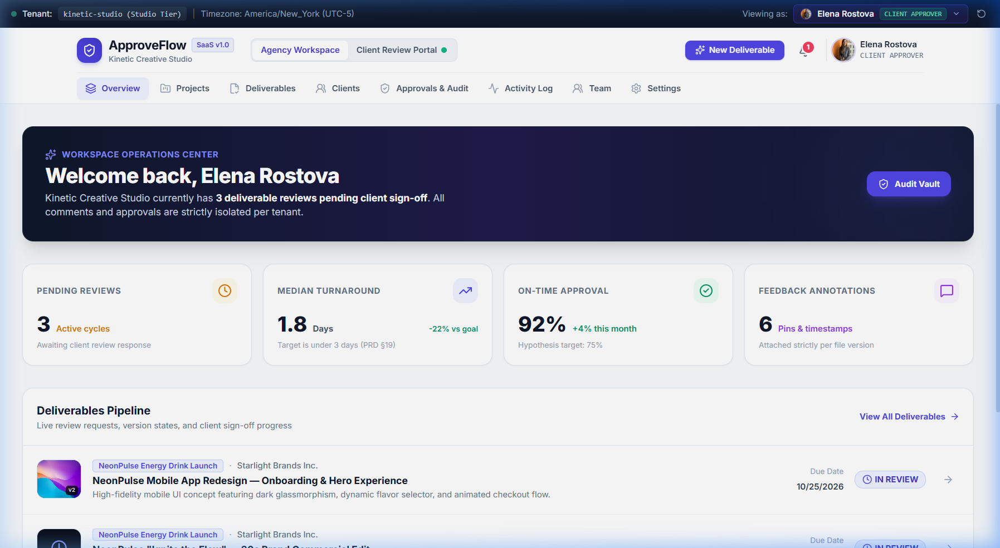
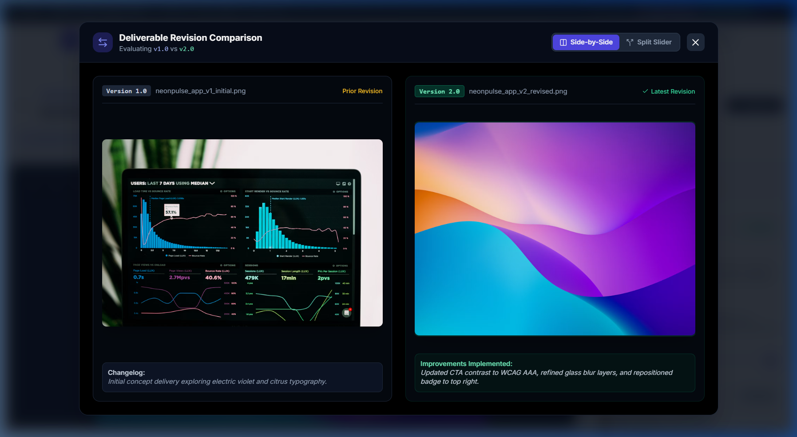
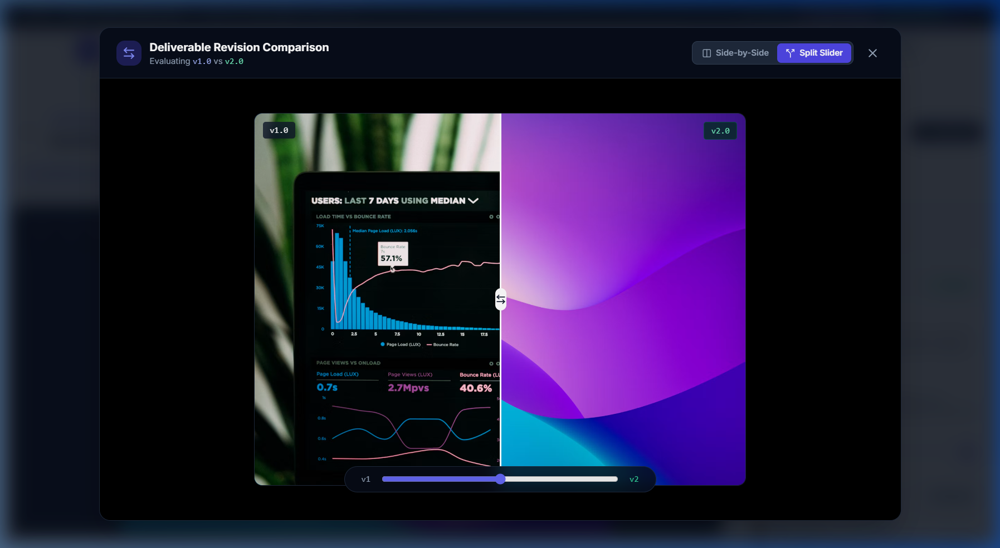
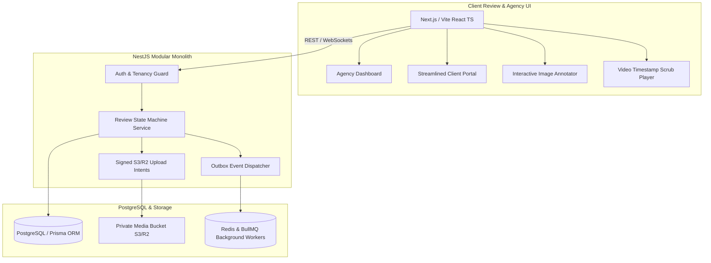

<div align="center">

# ⚡ ApproveFlow

### Client Review, Deliverable Management & Auditable Approval SaaS

**Make reviewing creative or technical deliverables as simple as opening a link — while giving agencies a secure, versioned, auditable record of every decision.**

[](https://react.dev/)
[](https://www.typescriptlang.org/)
[](https://vitejs.dev/)
[](https://tailwindcss.com/)
[](https://www.prisma.io/)
[](https://www.postgresql.org/)
[](https://opensource.org/licenses/MIT)

[Live Architecture](#-system-architecture) • [Features](#-core-features) • [Prisma Schema](#-database-schema) • [Quickstart](#-quickstart) • [Role Matrix](#-role-permission-matrix)

</div>

---

## 📸 Product Showcases

### 1. 🎯 Streamlined Client Review Portal
> *Deliberately simple, distraction-free portal designed for external client stakeholders to view assigned projects, pending sign-offs, and approved deliverable vaults.*

<p align="center">
  
</p>

---

### 2. 🎨 Interactive Visual Proofing & Annotation Engine
> *Pixel-accurate normalized coordinate pins (`{ x: 0.42, y: 0.68 }`), pan/zoom controls, threaded replies, and frame-accurate video timestamp comments (`MM:SS`).*

<p align="center">
  
</p>

---

### 3. 🔍 Revision Comparison & Interactive Split Slider
> *Side-by-side revision viewer and interactive draggable split divider slider allowing clients and art directors to verify that feedback requested on v1 was resolved in v2.*

<p align="center">
  
</p>

---

## 🌟 Core Features

### 📍 1. Normalized Image Annotation System (PRD §5.5)
- **Responsive Coordinate Math**: Pins are stored as relative floats (`x: 0.42, y: 0.68`) between `0.0` and `1.0`. Markers scale flawlessly across retina desktops, tablets, and mobile screens down to 360px.
- **Canvas Viewport**: Fluid zoom (50% to 300%), pan drag, fit-to-width, and quick-reset controls.
- **Bidirectional Pin Linkage**: Clicking a pin activates the thread in the sidebar; selecting or hovering a sidebar thread highlights and pulses the canvas pin.

### ⏱️ 2. Frame-Accurate Video Timestamp Feedback (PRD §5.6)
- **Millisecond Timestamp Storage**: Video comments store integer milliseconds (`timestampMs`), formatted as `MM:SS`.
- **Timeline Scrub Markers**: Visual pins plotted along the scrub bar corresponding to exact frame timestamps.
- **Pause & Drop Note**: One-click pause at current frame with auto-prefilled timestamp input.
- **Click-to-Seek**: Jump video playback directly to any comment's timestamp by clicking the thread.

### 🔄 3. Version Integrity & Revision Lifecycle (PRD §5.4 & §5.8)
- **Strict Version Scoping**: Every comment, pin, and approval belongs strictly to its version. Approving v1 does **not** approve v2.
- **Clean Supersession**: Publishing a new revision automatically marks outstanding prior review requests as `SUPERSEDED`.
- **Side-by-Side & Split Slider Diff**: Inspect visual improvements across revisions with an interactive divider.

### 🛡️ 4. Cryptographic Sign-Off & Audit Evidence (PRD §5.8, §6, §11)
- **Sign-Off Authorization**: Only designated `CLIENT_APPROVER` contacts can execute binding decisions. Agency staff cannot impersonate clients.
- **Tamper-Evident SHA-256 Proof Hash**:
  $$\text{Signature} = \text{SHA-256}(\text{ReviewID} : \text{VersionID} : \text{ActorID} : \text{Checksum} : \text{UTCTimestamp} : \text{Confirmation})$$
- **Official Certificate of Approval**: Generates a high-resolution, printable/exportable certificate with official verification seal, SHA-256 asset checksum, digital signature, and legal declaration.

### 👥 5. Live Multi-Tenant Persona Switcher
Switch instantly between personas in the top navigation bar to test permission boundaries in real time:
- 👑 **Sarah Jenkins** — `OWNER` (Kinetic Creative Studio)
- 💼 **Marcus Vance** — `MANAGER` (Kinetic Creative Studio)
- 🎨 **Chloe Lin** — `MEMBER` (Kinetic Creative Studio)
- ✍️ **Elena Rostova** — `CLIENT_APPROVER` (Starlight Brands Inc.)
- 💬 **David Kim** — `CLIENT_REVIEWER` (Starlight Brands Inc.)

---

## 🏗️ System Architecture



---

## 🔐 Role Permission Matrix (PRD §6)

| System Capability | Owner | Admin | Manager | Member | Client Reviewer | Client Approver |
|---|:---:|:---:|:---:|:---:|:---:|:---:|
| Manage workspace billing | ✅ | ❌ | ❌ | ❌ | ❌ | ❌ |
| Manage workspace settings | ✅ | ✅ | ❌ | ❌ | ❌ | ❌ |
| Invite internal members | ✅ | ✅ | ❌ | ❌ | ❌ | ❌ |
| Create client projects | ✅ | ✅ | ✅ | ❌ | ❌ | ❌ |
| Upload deliverables & versions | ✅ | ✅ | ✅ | ✅* | ❌ | ❌ |
| Request client reviews | ✅ | ✅ | ✅ | ❌ | ❌ | ❌ |
| View assigned deliverables | ✅ | ✅ | ✅ | ✅* | ✅ | ✅ |
| Annotate & comment on proofs | ✅ | ✅ | ✅ | ✅* | ✅ | ✅ |
| **Formal Sign-Off (Approve / Reject)** | ❌ | ❌ | ❌ | ❌ | ❌ | **✅** |
| View workspace audit logs | ✅ | ✅ | ❌ | ❌ | ❌ | ❌ |

*\*Requires assigned project membership. Agency staff cannot impersonate a client approver for binding sign-offs.*

---

## 🗄️ Database Schema

The production schema in [`prisma/schema.prisma`](prisma/schema.prisma) covers all **22 entities** specified in Section 7 of the PRD:

- **Identity & Tenancy**: `User`, `Session`, `Workspace`, `WorkspaceMember`, `Invitation`
- **Clients & Projects**: `ClientOrganization`, `ClientContact`, `Project`, `ProjectMember`, `ProjectClientAccess`
- **Deliverables & Assets**: `Deliverable`, `DeliverableVersion`, `FileAsset`
- **Review Workflow**: `ReviewRequest`, `ReviewParticipant`, `ReviewDecision`
- **Contextual Discussions**: `CommentThread`, `Comment`
- **Observability & Billing**: `Notification`, `AuditEvent`, `OutboxEvent`, `WorkspaceSubscription`

---

## 🚀 Quickstart

### Prerequisites
- Node.js `v20+` or `v22+`
- npm `v10+`

### Installation & Run

```bash
# 1. Clone repository
git clone https://github.com/Harshith-ka/ApproveFlow.git
cd ApproveFlow

# 2. Install dependencies
npm install

# 3. Launch development server
npm run dev
```

Open **[http://localhost:5175/](http://localhost:5175/)** in your browser.

### Build for Production
```bash
npm run build
```

---

## 📂 Repository Layout

```
approveflow/
├── docs/
│   └── images/                        # Showcase UI screenshots for README
│       ├── client_portal_overview.png
│       ├── interactive_proofing_engine.png
│       └── revision_comparison_slider.png
├── prisma/
│   └── schema.prisma                  # Complete 22-model PostgreSQL Prisma schema
├── server-spec/
│   ├── reviews.controller.ts          # NestJS Controller with idempotency & DTOs
│   ├── review-state-machine.service.ts # Transactional review state machine service
│   └── openapi.json                   # OpenAPI 3.0 specification
├── src/
│   ├── components/
│   │   ├── Navbar.tsx                 # Top bar persona switcher & mode toggle
│   │   ├── ImageAnnotator.tsx         # Normalized coordinate canvas engine
│   │   ├── VideoPlayerAnnotator.tsx   # Video scrub bar & timestamp markers
│   │   ├── CommentsSidebar.tsx        # Filterable threaded discussions
│   │   ├── ApprovalModal.tsx          # Formal sign-off modal with SHA-256 fingerprint
│   │   ├── ApprovalCertificateModal.tsx # Printable official Certificate of Approval
│   │   ├── VersionCompare.tsx         # Side-by-side & split slider revision diff
│   │   ├── NewDeliverableModal.tsx    # S3 signed upload intent simulator
│   │   └── NotificationsDrawer.tsx    # Real-time event notifications
│   ├── context/
│   │   └── AppContext.tsx             # State manager with LocalStorage persistence
│   ├── mock/
│   │   └── seedData.ts                # Creative deliverables (Images & Videos)
│   ├── types/
│   │   └── index.ts                   # Domain TypeScript definitions
│   └── views/
│       ├── DashboardView.tsx          # Agency KPIs, turnaround metrics, pipeline
│       ├── ReviewDetailView.tsx       # Core review screen (Image / Video proofing)
│       ├── ClientPortalView.tsx       # Distraction-free client review portal
│       ├── ApprovalsView.tsx          # Sealed approval evidence vault
│       ├── ProjectsView.tsx           # Client projects and deliverable progress
│       ├── DeliverablesView.tsx       # Deliverables library with category/status filters
│       ├── ClientsView.tsx            # Client organizations directory
│       ├── TeamView.tsx               # PRD §6 Permission Matrix table
│       ├── ActivityView.tsx           # Immutable workspace audit logs & JSON inspector
│       └── SettingsView.tsx           # PRD §15 Subscription tier entitlements
```

---

## 📄 License

Distributed under the MIT License. See `LICENSE` for more information.
